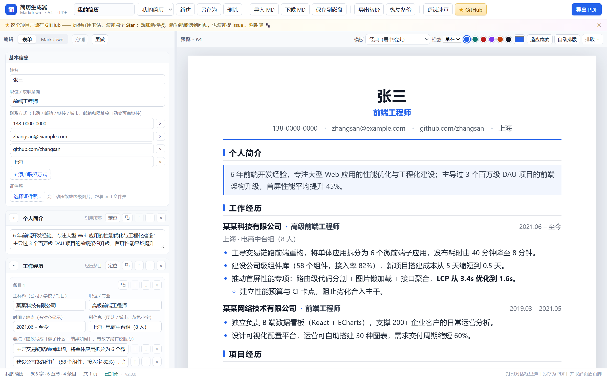
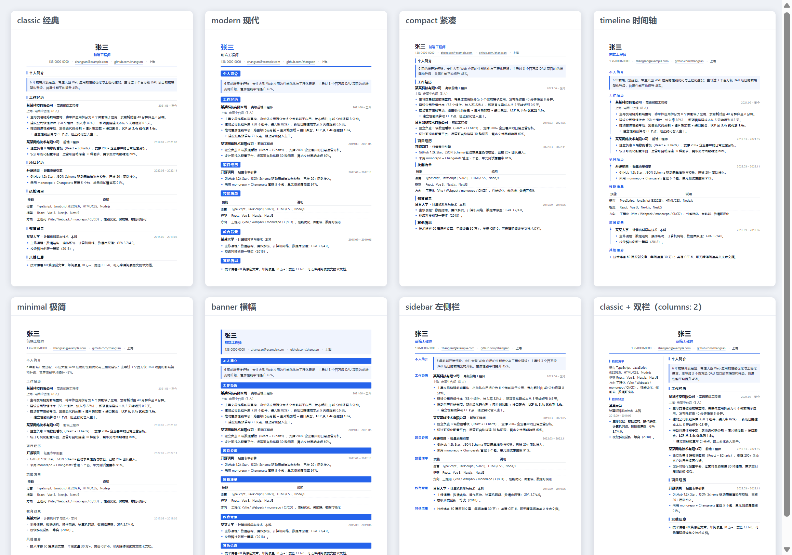

# 简历生成器

填表或写 Markdown 都能做简历，实时看 A4 排版，一键导出 PDF。**零依赖、纯本地**：不用装、不联网、不上传，一份 `.md` 就是你的简历。

> 在线版（GitHub Pages）：<https://beiwei91.github.io/resume-generator/> —— 手机、别人的电脑打开就能用；数据仍然只存在你自己的浏览器里。
>
> 觉得好用的话，欢迎到 [GitHub 仓库](https://github.com/beiwei91/resume-generator) 点个 ⭐ **Star**；遇到问题或想要新模板、新功能，也欢迎提 [Issue](https://github.com/beiwei91/resume-generator/issues)。谢谢喵 🐾



## 特性一览

- **两种编辑方式同一份文件**：表单（按模块填，不用写 Markdown）⇄ Markdown 原文，随时切换、实时互通
- **8 套模板**：经典 / 现代 / 紧凑 / 时间轴 / 极简 / 横幅 / 左侧栏 / **双栏**，主色、字体、字号、行距、页边距独立可调
- **所见即所得**：右侧就是 A4 预览，分页参考线、页数统计、实时字数
- **证件照**：一键插图，自动压缩内嵌进 `.md`，可调宽度 / 左右位置 / 圆角圆形
- **一页搞定**：排版面板里的「**压到一页**」自动收紧字号 → 行距 → 页边距 → 证件照，把内容压进一页
- **不丢东西**：撤销 / 重做（`Ctrl+Z` / `Ctrl+Y`）、章节与条目一键复制、自动保存、`Ctrl+S` 写回磁盘
- **好搬好备份**：导出 / 恢复 JSON 备份、下载 `.md`、拖拽 `.md` 进来即可导入；也提供了双击即用的**单文件便携版**
- **深色界面**：跟随系统 / 浅色 / 深色随你切，**纸张预览与导出的 PDF 始终是白底**
- **手机上能用**：窄屏一次显示一个面板，编辑 / 预览切换和「导出 PDF」都在**屏幕底部**，拇指够得到
- **零依赖**：没有框架、没有构建步骤、没有服务；直接打开 `index.html` 就能用

## 开始使用

三种方式，任选一种：

```powershell
# ① 推荐：双击「启动简历生成器.vbs」
#    用应用窗口打开（无地址栏、无标签页），没有后台进程，也不需要 Node

# ② 双击「简历生成器-单文件.html」
#    一个 HTML 文件搞定，拷到 U 盘、发给同事都能直接打开

# ③ 不要界面，直接把 Markdown 导出成 PDF（这条路需要 Node）
node export-pdf.mjs resume.sample.md -o 简历.pdf

# ④ 想要图片版（PNG 整页预览）用命令行，界面里不提供（浏览器零依赖做不到）
npm run png         # 生成 首页预览.png
```

界面左边填内容，右边就是 A4 预览。首次打开会载入示例简历，直接改就行。

## 两种编辑方式（同一份文件，随时切换）

左边默认是「**表单**」页签：**不用写任何 Markdown**，按模块填。

- **基本信息**：姓名、职位、联系方式（可增删多条）、证件照
- **每个章节一张卡片**：可折叠、可上移 / 下移 / 删除、可 **⧉ 复制**；「定位」会在右侧预览里高亮对应位置
- **经历条目**：主标题 / 职位 / 时间 / 副信息 分开填，要点逐条增删排序（二级要点有专门按钮），条目也能 ⧉ 复制
- **表格章节**（技能清单等）：直接改单元格、加行删行
- **要点列表 / 引用 / 正文**：按章节类型给对应编辑器
- **双栏模板**下每张章节卡片会多一个「**→ 左栏 / ← 右栏**」按钮，点一下即切换该章节在哪一栏
- 底部「**+ 添加章节**」按常见板块（工作经历、项目经历、教育背景、技能清单…）一键添加
- 改错了按 `Ctrl + Z` 撤销，`Ctrl + Y` 重做

切到「**Markdown**」页签就是原始文本，两边改动实时互通 —— 表单只是"看得见的编辑器"，底层存的仍然是 `.md`，所以文件照样能进 Git、发给别人、换电脑还原。

把 `.md` 文件直接**拖到窗口里**也能导入（拖 `.json` 备份则等于「恢复备份」，拖图片则是插入证件照）。

## 界面功能

**顶部工具栏**：文档名（也是导出 PDF 的文件名）、已保存文档、新建 / 另存为 / 删除、导入 MD、下载 MD、保存到磁盘、**导出备份 / 恢复备份**、语法速查、导出 PDF。

**编辑区**：表单 / Markdown 页签、撤销、重做；Markdown 模式下还有加粗、斜体、行内代码、章节、条目、要点、表格、分页、分隔线、**证件照**等插入按钮。

**排版面板**（预览区右上的「排版」）：

- 字体 / 字号 / 行距 / 页边距 / 缩放 / 分页参考线 / 自动保存
- 「**压到一页**」：自动依次收紧字号 → 行距 → 页边距 → 证件照宽度，压进一页即停；整体算一步，`Ctrl+Z` 可撤销，压不下去会**还原原样**并提示
- 「**界面主题**」：跟随系统 / 浅色 / 深色（只影响界面，纸张始终白底）
- 有证件照时多出宽度 / 位置 / 形状与「移除证件照」

| 快捷键 | 作用 |
| --- | --- |
| `Ctrl + S` | 保存（浏览器文档库，或用系统文件选择器写回磁盘） |
| `Ctrl + P` | 导出 PDF |
| `Ctrl + Z` | 撤销上一步 |
| `Ctrl + Y` / `Ctrl + Shift + Z` | 重做 |
| `Esc` | 关闭语法速查弹窗 / 排版面板 |
| `Ctrl + B` | 加粗选中文本（Markdown 模式） |
| `Tab` | 插入两个空格（Markdown 模式的列表里就是二级要点） |
| `Enter` | 列表项自动续写下一个标记（Markdown 模式） |
| 拖 `.md` / `.json` / 图片到窗口 | 导入文档 / 恢复备份 / 插入证件照 |

**手机上**：窄屏一次只显示一个面板，编辑 / 预览的切换条和「导出 PDF」固定在**屏幕底部**，顶部让出空间；表单字段一行一个，A4 纸自动缩放到屏幕宽度。

## 模板

预览区右上角的下拉框里切换，写在配置块里就是 `template: <名称>`：

| 名称 | 风格 | 适合 |
| --- | --- | --- |
| `classic` | 居中抬头、主色短竖条章节标题 | 通用、稳重（默认） |
| `modern` | 姓名主色、章节标题为主色胶囊块 | 互联网 / 设计岗位 |
| `compact` | 单行抬头、左侧主色竖条，行距更紧 | 内容多、想压到一页 |
| `timeline` | 经历左侧一条竖线 + 主色节点圆点 | 强调时间线 / 成长路径 |
| `minimal` | 去掉几乎所有框线，章节标题小号宽字距 | 极简、学术、英文简历 |
| `banner` | 章节标题整条主色横幅、抬头带浅底 | 想醒目、有设计感 |
| `sidebar` | 章节标题放在左侧留白栏，正文右移 | 结构清晰、偏杂志风 |
| `twocol` | 左栏 + 右栏两列 | 技能 / 证书多、想省竖向空间 |

### 双栏模板怎么用

切成 `twocol` 时，会**自动**把「技能 / 证书 / 荣誉 / 奖项 / 教育 / 语言 / 其他」这类章节放进左栏；之后在每张章节卡片上点「**→ 左栏 / ← 右栏**」随时调整。左栏里的表格会自动改成「标签：值」堆叠，窄列里也读得清；左栏条目改成标题、职位、时间各占一行的堆叠版式。

也可以手写配置：`rail: 技能清单, 证书与荣誉`（英文逗号 / 中文逗号 / 顿号都能分隔；写「技能」也能匹配到「技能清单」；改章节标题时这一行会跟着改）。

> 若 `rail` 里的章节名一个都匹配不上，版面会**自动退化成单栏**，不会留下空白条。



模板只管版式，主色 / 字体 / 字号 / 行距 / 页边距是独立设置，任意组合都会即时生效；有证件照时抬头会自动排成「文字 + 照片」两列。

## Markdown 语法

````markdown
---
template: classic        # 模板，见下方「模板」一节（共 8 套）
accent: #2563eb          # 主题色
font: sans               # sans（雅黑/苹方）| serif（宋体/思源宋体）
fontSize: 14px           # 10 ~ 20
lineHeight: 1.65         # 1.15 ~ 2.4
margin: 16mm 18mm        # 上下 左右
rail: 技能清单, 证书与荣誉   # 仅双栏模板用：放进左栏的章节
photo: ./证件照.jpg       # 证件照（可省略；见下方说明）
photoSize: 26mm          # 证件照宽度，高度按图片比例
---

# 张三                                      ← 姓名（第一个 # 标题）

前端工程师 | 138-0000-0000 | me@mail.com     ← 紧跟姓名：第一段是职位，
                                               其余按 | 拆成联系方式（邮箱/网址自动变链接）

## 工作经历                                 ← 章节

### 某公司 · 高级前端工程师 | 2021.06 – 至今   ← 条目：· 前主标题、· 后职位、| 后右对齐时间

**上海 · 电商中台组**                        ← 条目下第一段（含年份/·/| 时）是灰色副信息行

- 做了什么，结果如何：用数字量化
  - 行首两个空格 = 二级要点
- **加粗**、*斜体*、`代码`、[链接](https://example.com) 可混用

| 技能 | 说明 |                              ← 表格
| --- | --- |
| 语言 | TypeScript、JavaScript |

> 引用块（适合个人简介）

---                                          ← 单独一行 = 手动分页
***                                          ← 分隔线
````

文首配置块必须在文件最开头；界面上的排版控件会**自动改写文首配置块**，所以内容和样式永远在同一个文件里，换电脑导入即可还原。

### 证件照

点编辑区的「**证件照**」按钮选图即可：自动等比压缩（最长边 720px、JPEG）、铺白底，然后内嵌进 `.md`，抬头右上角立刻出现照片。想调大小或去掉，用「排版」面板里的宽度滑杆、「位置」（右侧 / 左侧）、「形状」（圆角 / 圆形 / 直角）和「移除证件照」。（想试效果可以直接拿 `assets/sample-photo.png` 当素材。）

**有照片时抬头会自动换成两列版式**：文字靠左、照片靠右（或靠左），两者垂直居中——不会出现"姓名被挤在居中列里、照片下面空一块"的别扭样子。

也可以手写（两种写法等价）：

```markdown
---
photo: ./证件照.jpg      # 或 https://… 、file:///D:/… 、data:image:…（内嵌）
photoSize: 26mm          # 宽度，默认 26mm（高度按图片比例）
photoAlign: right        # right（默认）| left
photoShape: rounded      # rounded（默认）| circle | square
---

# 张三

   ← 或者：写在姓名下一行的独立图片
```

照片地址支持相对路径、网址、`file:///` 与内嵌 data URI；写 Windows 绝对路径（`D:\photos\me.jpg`）会自动转成 `file:///D:/photos/me.jpg`。**推荐用按钮插入**（内嵌进 `.md`）：这样导出 PDF、发给别人、拷到别的电脑都不会丢图；用相对路径时，路径是相对**应用所在目录**，不是 `.md` 文件所在目录。

> 加证件照会让抬头变高一点（照片高度通常比姓名那几行高），原来刚好一页的简历可能被挤到第二页 —— 调小「证件照宽度」或精简几行即可。

一行 `` 也可以放进正文，图片不会超出纸张宽度。

## 导出 PDF

**方式一：界面「导出 PDF」**（推荐日常使用，手机上是底部那个蓝色按钮）

在弹出的打印对话框里：目标选「**另存为 PDF**」、**取消勾选「页眉和页脚」**、纸张 A4、缩放 100%，保存。页边距由简历自身决定，浏览器不会额外叠加。

导出的是矢量文字：可选中、可搜索、链接可点，中文字体已内嵌。

**方式二：命令行**

```powershell
node export-pdf.mjs resume.sample.md                      # 输出 resume.sample.pdf
node export-pdf.mjs 我的简历.md -o 张三-前端工程师.pdf
node export-pdf.mjs 我的简历.md --template modern --accent "#0f766e" --margin "14mm 16mm"
node export-pdf.mjs 我的简历.md --png 首页预览.png         # 额外导出首页 PNG
node export-pdf.mjs --help
```

参数 `--template / --accent / --font / --font-size / --line-height / --margin` 会临时覆盖配置块；`--png <文件.png>` 额外导出首页图，`--html <文件.html>` 额外导出可单独打开的 HTML；`--browser <路径>` 可指定浏览器（也会自动在常见安装位置查找）。

## 数据与备份

- **自动保存**：改动后约 1 秒写进浏览器 localStorage（键名前缀 `resume-gen:`），左下角状态栏会显示「已保存」；写不进去（存储满 / 隐私模式）时会**明确提示**，不会假装已保存
- **导出备份**：把浏览器里的**所有简历 + 排版偏好**打成一个 JSON 文件
- **恢复备份**：可「同名覆盖」或「只补充本地没有的」；如果备份覆盖了当前正在编辑的这份，界面会立刻换成恢复后的内容（否则下次自动保存会把刚恢复的版本覆盖回去）
- **换设备 / 长期保存**：用「下载 MD」或「保存到磁盘」把 `.md` 存成文件，`.md` 本身就是完整简历（含样式配置）

## 自检

```powershell
npm test            # 渲染引擎 51 + 表单逻辑 41 + 边界与不变式 110 = 202 项断言
npm run verify      # 导出链路 20 项：真的调 Chrome 出 PDF，校验 A4 尺寸、页边距、分页、
                    # 证件照进 PDF、双栏（rail）打印，以及「打印时不会夹带界面元素」
npm run verify:app  # 双击即用 / 窄屏 / 子路径部署等 105 项：图标、启动器命令与 URL 编码、
                    # 快捷方式、单文件版、表单渲染、窄屏规则、深色主题、双栏卡片按钮
```

合计 **327 项**，全部基于真实运行（`verify` / `verify:app` 会启动无头 Chrome 真出 PDF、真点按钮）。

## 目录结构

```
index.html                  工作台界面（表单 / Markdown 双模式 + 预览 + 导出）
assets/resume-md.js         渲染引擎：Markdown → 简历 HTML（浏览器 / Node 通用）
assets/resume-form.js       表单逻辑：把 Markdown 拆成模块并按块改写（可单测）
assets/form-view.js         表单界面：模块卡片、字段、增删排序、左右栏切换
assets/resume.css           简历纸张样式 + 8 套模板（预览与 PDF 共用）
assets/app.css / app.js     界面样式与逻辑（含深色主题、手机底部操作栏）
assets/icons/               图标（PNG + ICO，npm run icons 重新生成）
启动简历生成器.vbs            双击用应用窗口打开（无服务、无 Node）
创建桌面快捷方式.vbs          在桌面生成带图标的快捷方式
build-single.mjs            打包单文件便携版（npm run single）
简历生成器-单文件.html         单文件便携版（构建产物，双击即用）
export-pdf.mjs              命令行 PDF 导出
resume.sample.md            示例简历
tools/                      图标与启动器的生成脚本
tests/                      上面三个 npm 脚本对应的测试
可选-本地服务/                只有想把应用装成 PWA 时才需要，见目录内说明
```

## 常见问题

**表单模式识别不出我的内容？**
表单按固定约定认模块：`#` 姓名、`##` 章节、`###` 条目、`-` 要点、`|` 表格。不认识的复杂内容（嵌套引用等）会原样放进一个可编辑的「原文块」里，不会丢东西；实在特殊就切到 Markdown 页签改。

**表单里改动会不会破坏我的手工排版？**
不会。表单每次只重写"那一块"对应的几行，其余内容（包括文首配置块和手写的 Markdown 细节）一个字节都不动；测试里有一条不变式专门守这个（用原值改写后文档模型必须完全一致）。

**我改了内容/刷新后没生效？**
静态资源带版本号（`?v=x.y.z`），正常情况下刷新即可。如果线上看到的是旧样式，强刷一次（`Ctrl + F5`）或等一两分钟 CDN 缓存过期；左下角状态栏显示 `v1.7.1` 就说明拿到了新版。

**双栏模板里某个章节没进左栏？**
左栏由配置块里的 `rail:` 决定。用界面的话：在章节卡片上点「→ 左栏」。手写时注意章节名要能对上（支持英文逗号 / 中文逗号 / 顿号分隔，写「技能」也能匹配「技能清单」）；一个都没匹配上时版面会自动退化成单栏。

**深色模式下纸张为什么还是白的？**
这是有意的：深色只作用于界面。纸张预览与导出的 PDF 始终是白底，避免导出带底色、也避免打印时费墨。

**双击启动器后打开的是 Chrome 首页？**
说明 Chrome 没拿到合法的 `--app=` 值（实测：值不合法时 Chrome 就打开新标签页）。启动器已经把 URL 做了百分号编码，让命令行保持纯 ASCII；如果仍不行，直接双击 `简历生成器-单文件.html` 即可（等同双击普通网页，必定打开）。具体过程记在 `.launcher.log`。

**保存到磁盘时变成「下载」了？**
直接用浏览器打开本地 HTML（`file://`）时，浏览器不提供系统文件选择器，于是退化为下载，效果一样，只是要自己选保存位置。

**导出后多了一页，只有一两行？**
内容超出一页一点点。状态栏会显示「共 N 页」并高亮提醒。先试排版面板里的「**压到一页**」；也可以调小字号/行距、把页边距换成「窄」、精简要点，或在合适位置插一行 `---` 主动分页。

**「压到一页」压不下去？**
它会依次收紧字号 → 行距 → 页边距 → 证件照宽度，到极限仍放不下就**还原原样**并提示；这时只能精简内容或手动分页。

**界面里的「已保存」存在哪？**
浏览器 localStorage（键名前缀 `resume-gen:`）。清缓存或换浏览器就没了，重要简历请「下载 MD」或「保存到磁盘」留一份文件，或定期「导出备份」。

**能多人 / 多版本管理吗？**
`.md` 就是纯文本，放进 Git 就能看 diff、开分支、维护多份针对不同岗位的简历。

## 说明与限制

- 模板里只有 `twocol` 是两列；其余为单栏排版。没有滚动同步；页码依赖浏览器打印设置（程序不插入页码）。
- 双栏是「左栏 + 右栏」的浮动两列：内容跨页时，**第 2 页左侧会保留左栏的空位**（两列版式的固有表现），需要更紧凑时建议把内容压进一页。
- 预览里的虚线是估算的分页参考线，真实分页由浏览器打印引擎完成。
- 启动器和桌面快捷方式是 Windows 专用的 `.vbs`；macOS / Linux 直接双击 HTML 即可。
- `可选-本地服务/` 里是本地 HTTP 服务与 PWA（离线缓存）相关文件，默认用不到，只有想「安装成桌面应用」时才需要。

## 更新日志

- **1.7.1** 双栏左栏排版重做（改成真两列、表格变「标签：值」、不再丢列），修左栏按错配置时留白条的问题
- **1.7.0** 深色界面（跟随系统 / 浅色 / 深色）、手机底部操作栏（编辑 / 预览 + 导出 PDF）
- **1.6.0** 双栏更好用：章节卡片一键切左右栏、切模板自动填左栏；修一批撤销/重做与备份恢复的问题
- **1.5.0** 双栏模板 `twocol`、一键「压到一页」（含证件照自动缩放）
- **1.4.0** 撤销 / 重做、章节与条目复制、拖拽导入、导出 / 恢复备份、静态资源版本号（避免缓存旧版）
- **1.3.0** 证件照（内嵌、可调宽度/位置/形状）与抬头两列版式
- **1.2.0** 表单模式（按模块编辑，与 Markdown 实时互通）
- **1.1.0** 免服务启动器、单文件便携版、GitHub Pages 在线版
- **1.0.0** 首个可用版本：Markdown → A4 预览 → 导出 PDF

## 许可

MIT
